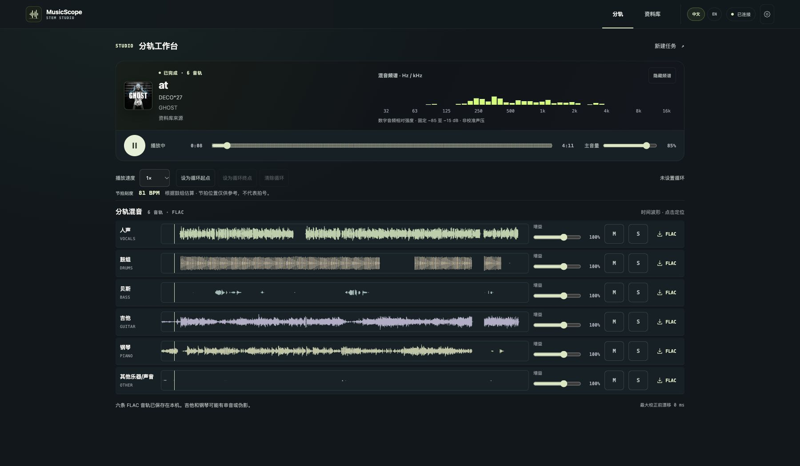
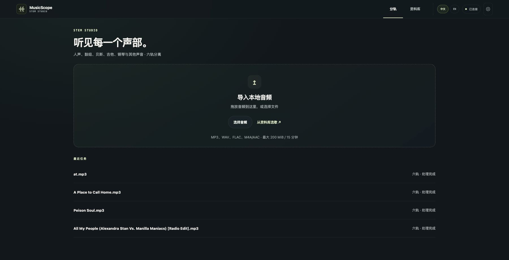
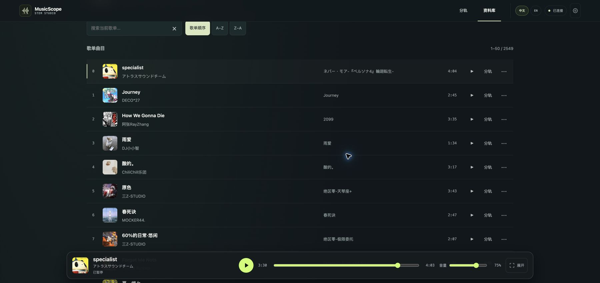
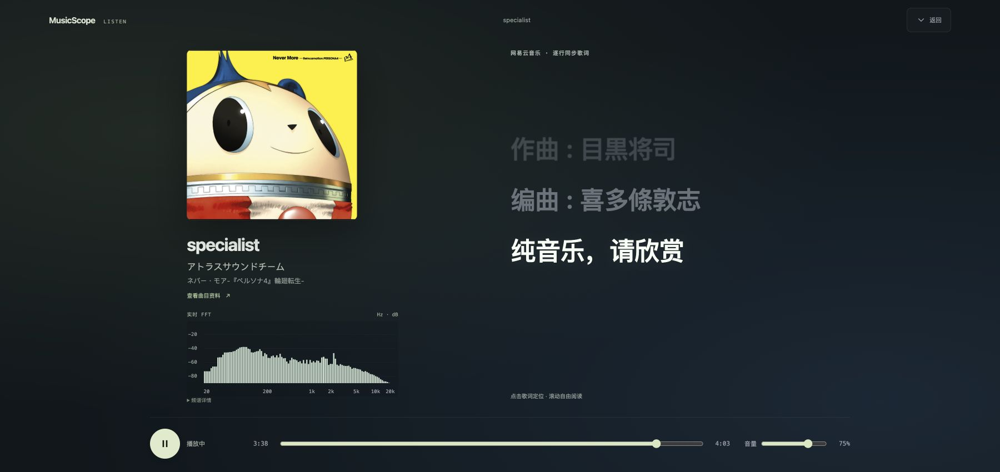

<h1 align="center">MusicScope</h1>

<p align="center"><strong>听见每一个声部。</strong><br>把喜欢的歌，拆成可以聆听、练习和再创作的六条音轨。</p>

<p align="center">A local-first six-stem music studio. Separate, mix, practice, and export.</p>

<p align="center">
  <a href="https://github.com/sevenlemoon/MusicScope-V2/releases/tag/v0.1.0-beta.1"></a>
  
  
</p>

<p align="center">
  <a href="#界面预览">界面预览</a> ·
  <a href="#快速开始">快速开始</a> ·
  <a href="#使用流程">使用流程</a> ·
  <a href="#开发与架构">开发与架构</a> ·
  <a href="https://github.com/sevenlemoon/MusicScope-V2/issues">反馈问题</a>
</p>

MusicScope 是一款在自己电脑上运行的音乐分轨工作室。导入本地音频，或从网易云资料库选择当前账号可播放的歌曲，即可用 Demucs 分离出 **人声、鼓组、贝斯、吉他、钢琴和其他声音**，在同一个工作台里试听、调节和导出。

## 界面预览

以下为 **2026-10-21 本地开发版实机截图**。六轨工作台与播放器均在实际播放时拍摄；截图中的新版布局、歌词和频谱展示尚未全部进入默认分支或 beta.1 发布包。版本与截图来源见 [预览记录](docs/README_SHOWCASE.md)。



| 本地音频导入 | 网易云资料库 |
| :---: | :---: |
| [](docs/screenshots/readme/studio-import.jpg) | [](docs/screenshots/readme/library.jpg) |
| 不需要登录，从自己的文件开始 | 从已同步的歌曲进入播放或分轨 |

<details>
<summary>展开查看开发版播放器：封面、歌词阅读与实时频谱</summary>



</details>

## 可以做什么

| 能力 | 使用方式 |
| --- | --- |
| **六轨分离** | 使用 Demucs `htdemucs_6s`，分别得到人声、鼓、贝斯、吉他、钢琴与其他声音。 |
| **两种音源** | 上传自己的音频，或扫码连接网易云，从“我喜欢的音乐”选择可播放曲目。 |
| **逐轨混音** | 查看各轨时间波形，独立调整增益、静音或独奏，点击波形定位。 |
| **循环练习** | 以 0.75×、1×、1.25× 速度试听，设置 A–B 循环；新任务在节奏证据充足时提供估算 BPM 与节拍刻度。 |
| **FLAC 导出** | 下载各声部的 FLAC 文件，供后续练习或在其他音频工具中使用。 |
| **本机资料库** | 同步喜欢的歌曲、自己创建的歌单与明确收藏的专辑，提供中英文界面。 |

音频分离在本机完成。网易云连接、资料同步与在线音源仍需要网络；模型和依赖需要在首次使用时下载。分离结果可能存在串音或伪影，尤其是吉他与钢琴声部。

## 快速开始

### Windows：下载桌面预览版

**[下载 MusicScope v0.1.0-beta.1](https://github.com/sevenlemoon/MusicScope-V2/releases/tag/v0.1.0-beta.1)**

1. 下载 `MusicScope-0.1.0-beta.1-windows-x64.zip`，完整解压到可写目录。
2. 打开 `MusicScope.exe`，等待窗口完成首次运行环境准备。
3. 导入音频，开始六轨分离。模型会在首次分轨时下载。

适用 Windows 10/11 x64，无需手动安装 Node、Python、Docker、WSL2 或数据库，建议预留至少 10 GB 空间。**beta.1 首次启动需要联网准备运行组件，并非全离线安装包。** 当前预览包没有 MusicScope 自有代码签名证书。

桌面版资料保存在 `%APPDATA%/MusicScope/workspace`，更新时请保留该目录；已有源码版或 Docker 资料不会自动迁入。关闭应用会停止它启动的服务，请等待分轨任务结束后退出。详细验证范围见 [发布说明](docs/releases/desktop-0.1.0-beta.1.md)。

### macOS：从源码启动

默认分支的 macOS 启动器适用 **Apple silicon**，需要 Docker Desktop、[uv](https://docs.astral.sh/uv/)、FFmpeg（含 ffprobe）和 Node.js **24.21.0 或更新的 24.x**。先启动 Docker Desktop，再运行：

```bash
git clone https://github.com/sevenlemoon/MusicScope-V2.git
cd MusicScope-V2
nvm install
./MusicScope.command
```

`nvm install` 适用于已安装 nvm 的环境；也可以自行准备符合版本要求的 Node.js。之后可直接双击 `MusicScope.command`。

启动器准备依赖、数据库迁移和音频 worker，浏览器会自动打开 **[http://127.0.0.1:3100](http://127.0.0.1:3100)**。首次安装需要联网；后续复用已下载的依赖与模型。默认分支仍使用 Docker/PostgreSQL；开发中的 macOS SQLite 启动器尚未合并。

<details>
<summary>Windows 源码启动、状态检查与旧资料库</summary>

下载并完整解压源码后，双击 `MusicScope.cmd`。首次启动会准备 Node.js、uv、Python 3.12、FFmpeg/ffprobe、前后端依赖和音频引擎，资料库使用 `storage/library.sqlite3`。等待终端显示 `APPLICATION READY`，浏览器会自动打开。

| 操作 | macOS | Windows PowerShell |
| --- | --- | --- |
| 只读检查状态 | `./scripts/dev.sh --status` | `./scripts/dev.ps1 -Status` |
| 仅准备环境 | `./scripts/dev.sh --setup` | `./scripts/dev.ps1 -Setup` |
| 启动但不打开浏览器 | `./scripts/dev.sh --no-open` | `./scripts/dev.ps1 -NoOpen` |
| 使用旧 Docker 资料库 | 默认使用 PostgreSQL | `./MusicScope.cmd -LegacyDocker` |

Windows 源码版 SQLite 与旧 PostgreSQL 资料独立，不会自动迁移或删除旧数据库卷。更新源码时保留 `.env`、`.tools`、`storage` 和数据库卷。下载中断后可重新运行启动器；安装日志位于 `.logs/`。关闭启动终端会停止该窗口启动的服务。

</details>

## 使用流程

1. **选择音源**：导入 MP3、WAV、FLAC、M4A/AAC，或在连接页生成二维码，用网易云官方手机应用扫码确认后同步资料库。本地导入无需账号，文件上限为 **200 MiB / 15 分钟**。
2. **开始分轨**：提交六轨任务，等待音源准备、模型加载、分离和波形生成。首次任务会额外下载模型；处理耗时取决于音频长度与硬件。
3. **试听与练习**：播放同步音轨，用独奏听清某个声部，用静音制作练习伴奏；配合变速与 A–B 循环反复练习。
4. **保存结果**：下载需要的 FLAC 声部。任务结果保存在本机，返回已完成任务无需重新分离。

网易云登录不需要在 MusicScope 输入账号密码，会话保留在本机服务端。曲目是否可导入取决于当前账号能否取得可播放音源；请仅处理自己有权使用的音频。

## 开发与架构

```text
Next.js / React / TypeScript
              │
          FastAPI API
           ├── SQLAlchemy → SQLite（Windows）/ PostgreSQL（macOS）
           ├── 网易云连接服务 → 资料同步与可播放音源
           └── 本地任务队列 → Python audio worker → Demucs / FFmpeg
                                                    └── FLAC / 波形 / 估算节拍
```

| 目录 | 职责 |
| --- | --- |
| `apps/web` | 分轨工作台、资料库、播放器与中英文界面 |
| `apps/api` | HTTP API、资料同步、任务与音频文件管理 |
| `apps/audio-worker` | 独立音频环境、模型推理、音轨校验与波形生成 |
| `apps/desktop` | Windows Electron 桌面外壳 |
| `services/netease-api` | 仅绑定本机的网易云连接服务 |
| `contracts` | OpenAPI 合约与前端类型来源 |

已配置开发环境后，可运行 `make check` 检查合约、静态分析、测试、数据库、依赖与前端构建；音频 worker 使用独立环境，需另行运行其测试。更多说明见 [架构设计](docs/ARCHITECTURE.md) · [领域模型](docs/DOMAIN_MODEL.md) · [桌面版发布说明](docs/releases/desktop-0.1.0-beta.1.md)。

MusicScope 当前面向**单机本地使用**，服务绑定 `127.0.0.1`。`X-MusicScope-User-ID` 用于本地用户选择，不是公网身份验证；共享或远程部署需要另行设计认证、TLS 和访问控制。请勿提交 `.env`、账号会话、个人音频、分轨文件或模型缓存。

## 常见问题

**必须登录网易云吗？** 不需要。本地文件导入和分轨可独立使用。

**可以完全离线吗？** 依赖与模型准备完成后，本地音频分轨可使用已下载的组件。首次初始化、模型下载与网易云功能需要联网。

**没有独立显卡可以运行吗？** 可以使用 CPU，长音频处理可能较慢。macOS 优先使用 MPS，Windows 检测到可用 CUDA 时使用 CUDA，否则回退 CPU；可在本地 `.env` 中设置 `AUDIO_WORKER_DEVICE=cpu`。

**为什么吉他或钢琴还有其他声音？** 模型分离并不保证完全独立。不同录音、混音与乐器组合会影响效果；BPM 与节拍也属于估算，不是乐谱级转录。

**下载后界面为什么和截图不同？** 截图来自 2026-10-21 的本地开发版，包含尚未发布的界面更新；beta.1 与默认分支以各自实际代码为准。

## 反馈与致谢

欢迎通过 [Issues](https://github.com/sevenlemoon/MusicScope-V2/issues) 反馈问题或建议。请提供操作系统、使用版本、复现步骤和经过脱敏的错误信息；界面问题可附截图，避免上传账号会话或私人音频。

音频处理基于 [Demucs](https://github.com/facebookresearch/demucs)、[PyTorch](https://pytorch.org/) 与 [FFmpeg](https://ffmpeg.org/)，网易云连接使用 [NeteaseCloudMusicApiEnhanced](https://github.com/NeteaseCloudMusicApiEnhanced/api-enhanced)。感谢这些项目提供的基础能力；第三方组件与模型遵循各自的许可条款。
