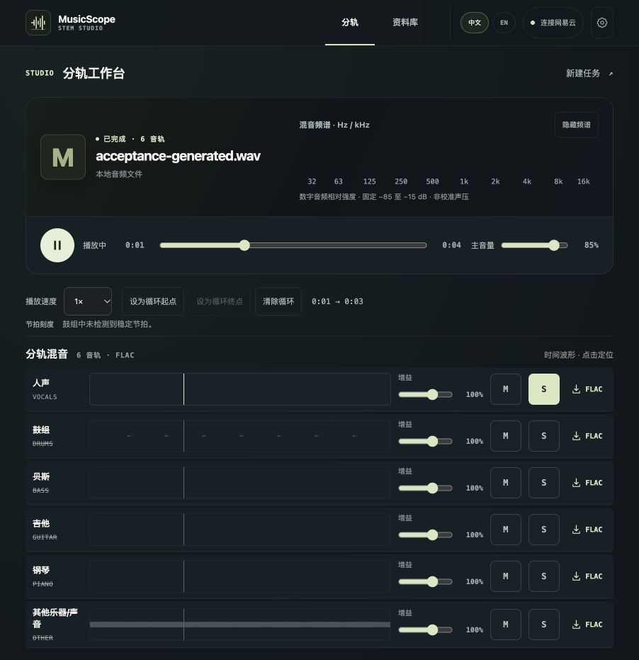

# 项目代码审查与清理验收（2026-10-21）

本轮基于 `92caf1d` 与工作区已有未提交改动进行审查。保留原始改动后建立 `codex/project-review-20261021`，分别提交原有功能、本次修复、依赖修复、桌面验收修复和清理。没有合并默认分支、发布安装包或重置个人资料库。

## 核心入口与数据流

| 层级 | 当前职责与数据流 |
| --- | --- |
| Next.js App Router | `/`、`/studio` 上传；`/library` 集合浏览；歌曲、歌单、专辑详情；连接和设置；`/studio/jobs/[id]` 任务及混音 |
| React 组件及 hooks | CollectionBrowser 维护集合与分页；URL 和会话快照维护返回位置；PlayerProvider 和 Studio 通过 playback coordinator 共享播放所有权；歌词按曲目加载，频谱读取真实 Web Audio 数据 |
| FastAPI | catalog/library 返回规范化曲目；连接服务加密保存来源会话；Studio 流式上传、去重、配额检查、持久任务和用户范围内的 Range 文件访问 |
| SQLAlchemy | SQLite / PostgreSQL 保存规范化实体、同步快照、任务、音频文件索引；Alembic 保留既有升级路径 |
| audio-worker | 独占领取任务，准备模型，运行 Demucs/FFmpeg，校验六轨 FLAC，生成波形和估算节拍，原子发布结果 |
| 桌面外壳与启动器 | Windows Electron 启动内置运行时；macOS 启动器管理本机服务；来源 sidecar 只绑定 loopback |

审阅了说明、AGENTS.md、依赖与锁文件、CI、启动/构建脚本，并检查了来源边界、加密与脱敏、同步与集合查询、播放所有权、上传与存储路径、worker 任务/进程生命周期和桌面页面验收。

## 修复的问题

| 问题 | 修复与验证 |
| --- | --- |
| API 错误响应含 `detail: null` 时被 TypeError 覆盖 | 对错误载荷做空值和字段类型检查，保留 HTTP 状态及安全消息；覆盖空值、数组、错误字段类型和正常结构化错误 |
| 切换曲目详情时旧请求覆盖新页面 | 按曲目隔离组件生命周期，取消请求并忽略卸载后的结果；测试反序返回 |
| 会话快照为 JSON `null` 时资料库崩溃 | 验证快照、查询与滚动位置结构，忽略损坏条目；测试多个无效存储形态 |
| 极大分页游标超过数据库整数范围 | 将无效游标归零并为分页运算预留范围；测试 64 位溢出与超长数字 |
| 数字格式创建者 ID 导致自建歌单被排除 | 统一为字符串比较；测试默认喜欢集合与个人歌单详情一致可见 |
| 收藏专辑没有喜欢曲目时艺人信息消失 | 个人专辑详情直接读取 AlbumArtist；测试收藏专辑没有喜欢曲目仍显示艺人 |
| 源文件丢失后重新上传仍返回失效记录 | 修复已有音频记录的存储路径，保留被任务引用的 ID；避免重复计算配额；测试恢复后的文件内容与 ID |
| 数据库异常导致分离子进程遗留 | worker 在所有退出路径回收自己启动的进程；用真实阻塞子进程与数据库异常复现并回归 |
| 歌单第一首显示为 0 | 保持 API 的零起始位置，在界面转换为一开始的序号；覆盖第一首和搜索后的原始位置 |
| 桌面打包冒烟检查仍依赖旧 CSS 与播放字符 | 提取自包含页面检查函数，使用稳定控件标记及 `aria-pressed`；打包脚本包含新模块，前端测试直接调用同一检查函数 |
| sidecar 重定向库高危漏洞 | 锁文件将 follow-redirects 1.16.0 更新到 1.16.1；来源、加密兼容测试及完整 npm audit 通过 |
| API / worker 信任库包含受影响的根证书 | pip-audit 发现 PYSEC-2026-4320；两个 uv.lock 的 certifi 从 2026.7.22 升至 2026.10.19，同步锁定环境后复查归零 |

## 清理与保留

- 删除未使用的 R0 EntityShell、metadata provider 空协议、API 类型包装、旧 hook 转发和旧资料库 CSS module。
- 删除只被自身测试引用的旧导航清单及对应测试，移除已退休入口的图标。
- 检查所有运行时代码、动态 className、状态类、App Router 自动入口、导入关系与构建/打包脚本后，移除 273 个不可达的全局 CSS 选择器；保留动态 `status-*` 类和有效组件样式。
- 移除 macOS 启动脚本对已退休 recommendations/profile 接口的请求。
- 212 个既有本地截图、录像、日志、临时探针和进度文档已归档到忽略目录 `.local/review-history/20261021/`，没有删除；原始已跟踪 diff 和未跟踪文件还在 `/tmp/musicscope-review-20261021/` 留有快照。
- 增补备份、编辑器交换文件、日志、SQLite、浏览器测试输出和本地归档忽略规则；检查未发现已跟踪的运行缓存、音频存储或构建目录。
- 增加文档索引和历史文档标记，以及可单独执行的 `make worker-check`。
- 保留历史数据库表、Alembic 迁移和四轨任务读取/处理能力，避免已有资料与结果失效。
- 保留来源适配器中的已测试只读发现方法，以及旧 `/tracks/{id}/stem-jobs` 导航响应接口：当前页面使用新的直接分轨接口，但无法确认外部使用者是否仍依赖公开接口，故不做破坏性删除。

## 已执行验证

| 验证 | 结果 |
| --- | --- |
| `make check` | 通过：OpenAPI 与生成类型一致、Ruff、编译检查、ESLint、TypeScript、测试、依赖审计门槛、数据库迁移 SQL、数据库完整性、生产构建与 Compose 配置 |
| API pytest | 107 通过；两个依赖弃用警告仍保留 |
| Web Jest | 19 个套件、214 项测试通过 |
| `make worker-check` | Ruff、编译检查与 19 项 worker 测试通过 |
| `npm --prefix apps/desktop run check` | JavaScript 语法检查与 5 项 supervisor 测试通过 |
| macOS 启动器 | 4 项测试通过；`dev.sh`、`start_mac.sh`、`MusicScope.command` 的 Bash 语法检查通过 |
| 依赖与许可适配 | 7 项来源/加密测试、4 项 notice 测试和 3 项目录 glob 适配测试通过 |
| npm audit | sidecar 和 desktop 为 0；web 生产依赖为 0，全量开发依赖仍有 19 个中危条目（同一 sprintf-js 来源链），没有高危或严重告警 |
| Python 依赖审计 | 对锁定同步后的 macOS API 和 worker 已安装依赖执行 pip-audit，已知漏洞均为 0；证书依赖更新后再次运行 API、Web 和 worker 全量测试通过；[审计摘要](review-dependencies-2026-10-21.json) |
| 真实引擎 | 独立 SQLite、API 与 worker，以 4 秒确定性合成音频运行 CPU htdemucs_6s；15.8 秒完成六轨分离，六个 FLAC SHA-256、下载、解码和波形验证通过；[结果 JSON](review-audio-2026-10-21.json) |
| 浏览器 | 读取既有真实资料库；在独立生产实例验证未连接账号与集合选择器空状态、真实任务结果、六轨播放与结束、定位、静音、独奏、AB 起止与循环播放；测试后暂停并清除练习状态 |
| 生产模式 | 默认 Turbopack 构建通过；隔离源代码镜像另以 webpack 生产构建，连接临时 API 做浏览器验收，避免改变个人服务配置 |
| 最终 diff 与敏感内容 | `git diff --check` 通过；常见令牌与私钥模式扫描没有命中；个人配置、会话、源音频、分轨文件和历史原始验收资料没有进入提交 |

## 已知限制与未验证项

- 本机是 macOS，尚未执行这次改动对应的 Windows Electron 安装包、PowerShell 原生启动、离线搬移验收；需要以推送后的 Windows CI 结果为准。本轮修复并测试了页面检查契约，不能据此声称整个 Windows 包已通过。
- Python 漏洞审计覆盖本机实际安装的依赖，不代表未安装的 Windows 专属条件依赖已经完成审计。
- 没有重新扫码登录、触发真实账号同步或完整重测所有在线曲目的播放/版权状态。来源依赖可用性、账号权限和 CDN 行为继续受外部环境影响。
- 没有进行扬声器人工听音或音质评估，4 秒合成音频验收仅验证工程链路；没有新增 CUDA/MPS 性能结论。
- 浏览器验收使用当前桌面视口；历史手机截图仅留存，不当作本轮移动设备实机验收。
- `sprintf-js` 的中危告警仅在 Jest 开发工具链中；兼容范围更新未能消除，审计建议强制降级 Jest 至 25。保留现有 Jest 30，不使用破坏性降级或降低现有审计门槛。
- 单机本地部署的用户选择机制不等于远程认证；本轮没有增加公网或共享多用户部署能力。

